# UrbanSphere — System Architecture

```mermaid
flowchart TD
    subgraph Canonical_Data_Layer ["1. Canonical Datasets (data/)"]
        WeatherAQI["dataset_weather_gurugram_with_aqi.csv\n(315,648 rows, 15 cols, 2022-2024)\n- Synthetic Hourly Meteorological Benchmark"]
        Traffic["dataset_traffic_gurugram.csv\n(315,648 rows, 18 cols, 2022-2024)\n- Synthetic Hourly Traffic & IRC-67 PCU"]
        AirQuality["dataset_air_quality_gurugram.csv\n(315,648 rows, 14 cols, 2022-2024)\n- Synthetic Hourly Criteria Pollutants & AQI"]
        Geography["dataset_geography_gurugram.csv\n(12 rows, 11 cols)\n- Approximate Locality Reference Centroids"]
    end

    subgraph Integration_Layer ["2. Data Integration Pipeline (data/build_integrated_analytical_dataset.py)"]
        HourlyInt["Master Unified Hourly Dataset\n(data/processed/integrated/urban_integrated_hourly.parquet)\n- 315,648 rows, 51 cols\n- 1:1 join on (timestamp, location_name)"]
        DailyInt["Daily Analytical Dataset\n(data/processed/integrated/urban_integrated_daily.parquet)\n- 13,152 rows, 44 cols\n- Aggregated daily features across 1,096 days x 12 localities"]
        Provenance["Integration Metadata & Invariants\n(data/processed/integrated/integration_metadata.json)\n- Provenance checks, physical constraints, zero data loss"]
    end

    subgraph Distributed_Compute ["3. Big Data Distributed Analytics"]
        HDFS["HDFS Storage Organization\n- /urbansphere/data/processed/"]
        MapReduce["Hadoop Streaming MapReduce\n- Hourly Traffic PCU Aggregation\n- Spatial Locality Vehicle Summaries"]
        PySpark["PySpark SQL & Analytics Engine\n- Corridor Capacity Stress\n- Vehicle Modal Split\n- Seasonal Air Quality Profiles\n- Wind Pollution Dispersion"]
    end

    subgraph ML_Analytics ["4. Machine Learning & Statistical Analytics"]
        RF["Random Forest AQI Classifier\n- 10-feature weather-driven AQI prediction\n- 85%+ cross-validation accuracy"]
        KMeans["K-Means Multi-Pollutant Regimes\n- K=3 optimal clustering (Silhouette: 0.54)\n- PCA 2D spatial projection"]
        IForest["Isolation Forest & PM Z-Score\n- Severe atmospheric stagnation anomalies (658 episodes)"]
        Corr["Multivariate Correlations\n- Pearson/Spearman matrix with two-tailed p-values"]
    end

    subgraph Backend_Serving ["5. FastAPI High-Performance Analytics Backend"]
        FastAPI_App["FastAPI REST Service (backend/app/main.py)\n- 17 REST endpoints under /api/v1\n- Real-time ML inference: POST /predict/aqi & /predict/regime\n- In-memory cached analytical data loader"]
    end

    subgraph Frontend_UI ["6. Urban Analytics Dashboard (frontend/)"]
        DevServer["Node.js Dev Server (frontend/dev-server.js)\n- Starts via npm run dev\n- Serves modern SPA on http://localhost:3000\n- Proxies /api/v1 to FastAPI backend"]
        Views["Interactive UI Views\n- Overview (KPIs, Map, Live Locality Table, Trends, Insights)\n- Traffic Corridor Capacity & Modal Split\n- Air Quality NAAQS Thresholds & Daily Timeline\n- Weather Climatology & Wind Dispersion\n- Geographic Locality GIS Reference\n- Analytics & Live ML Prediction Workbench\n- Data Explorer & Academic Reports"]
    end

    Canonical_Data_Layer --> Integration_Layer
    Integration_Layer --> Distributed_Compute
    Integration_Layer --> ML_Analytics
    Distributed_Compute --> Backend_Serving
    ML_Analytics --> Backend_Serving
    Backend_Serving <--> DevServer
    DevServer --> Views
```

## System Components & Data Flow

1. **Canonical Benchmark Datasets (`data/`)**:
   - `dataset_weather_gurugram_with_aqi.csv`: 315,648 rows across 12 localities and 3 years (2022–2024).
   - `dataset_traffic_gurugram.csv`: 315,648 rows with 6 vehicle classes, PCU, and congestion classifications.
   - `dataset_air_quality_gurugram.csv`: 315,648 rows of criteria pollutants (PM2.5, PM10, NO2, SO2, CO, O3) and calculated AQI.
   - `dataset_geography_gurugram.csv`: 12 representative reference points, locality types, and arterial corridor references.

2. **Data Integration Engine**:
   - Validates physical invariants: non-negative counts, sum of vehicle subclasses equals `vehicle_count`, and `PM10 >= PM2.5`.
   - Produces clean Snappy-compressed Parquet files for fast vector reading.

3. **Hadoop MapReduce & PySpark SQL**:
   - Hadoop MapReduce jobs run streaming aggregations over hourly records.
   - PySpark processes SQL window aggregations for corridor capacity stress, monthly climate cycles, and seasonal pollution profiles.

4. **Machine Learning Pipelines**:
   - Scikit-Learn models trained and persisted in `output/models/`: Random Forest AQI Classifier, K-Means Multi-Pollutant Regimes, and Isolation Forest Anomaly Detection.

5. **FastAPI Backend & Interactive Frontend**:
   - FastAPI server (`backend/app/main.py`) exposes analytical data and ML inference endpoints.
   - Frontend SPA runs via `npm run dev` with responsive dark glassmorphism UI, vector SVG/Canvas charting, and live backend integration.
